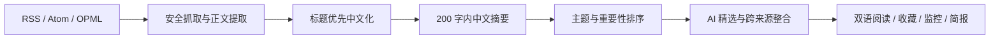

# 大爷的 RSS

> 把分散在几十个信息源里的内容，整理成每天真正值得读的少数几条。

大爷的 RSS 是一款面向 RSS 重度用户、科技从业者和投资研究者的个人 AI 阅读器。它不是简单给文章加一个聊天框，而是把 AI 放进完整的信息处理链路：抓取、去重、中文化、摘要、重要性排序、精选、跨来源整合和按需全文翻译。

项目同时提供两种运行方式：

- **Android 本地独立版**：不需要服务器和登录，数据留在手机，适合个人直接使用。
- **个人云端版**：Fastify + SQLite + Docker，适合全天候抓取、定时简报和跨设备访问。

## 核心工作流



1. **聚合真实来源**：订阅 RSS/Atom、导入 OPML，并展示每个来源的刷新状态和错误。
2. **先处理最容易扫读的信息**：先完成全部双语标题，再在后台生成简短中文 Markdown 摘要。
3. **减少噪音**：按主题、时效、来源质量和重要性排序；AI 精选只从候选中选出少量内容，而不是把所有文章都叫“精选”。
4. **建立关联**：只有相关文章达到相关性门槛时，才生成跨来源观点整合，并保留证据文章。
5. **按需付费计算**：文章列表默认不做全文翻译；用户打开文章后才提取更完整正文并启动双语翻译。
6. **形成个人信息闭环**：收藏、稍后读、阅读历史、监控规则、每日简报和资料库问答共同沉淀长期研究资料。

## 已实现能力

### 订阅与内容处理

- RSS、Atom、OPML 导入；云端版支持 OPML 导出
- 内置 92 个技术类 RSS 来源，其中 90 个 HTTPS 来源默认可用，2 个 HTTP 来源因本地安全策略默认暂停
- 多来源并发刷新、重复文章识别、来源状态与失败原因展示
- Feed 正文、网页正文和媒体图提取；使用 Readability 与回退规则提升长文完整度
- 动态阅读时长，根据正文长度计算，不使用固定占位值
- 来源 Logo / favicon、文章原图、中文主标题和英文副标题

### AI 阅读与研究

- 中文 Markdown 摘要，程序侧强制限制在 200 个 Unicode 字符以内
- 默认双语标题；英文文章打开后按需生成逐段中英对照
- 摘要、翻译、分析可分别绑定不同模型，例如用 DeepSeek 做摘要/翻译，用更强模型做跨文章分析
- 每个角色最多配置 4 个候选模型；主模型失败后自动尝试备用模型，并显示运行、降级或错误状态
- DeepSeek 翻译使用独立高并发池；云端默认 64，可通过环境变量在 8–128 之间调整
- AI 精选、跨来源观点整合、文章/主题/资料库问答与来源证据

### 阅读体验

- “今日”卡片流与向下延伸的时间轴
- 精选来源、继续关注、主题/重要程度/来源标签
- 收藏、稍后读、已读状态和阅读历史
- 文章卡片、悬浮操作栏、液态玻璃控件、浅色/深色模式
- 手机、平板、横屏和折叠屏响应式布局；针对 vivo X Fold 类设备的内外屏切换和安全区处理
- PWA 离线应用外壳与 Capacitor Android 容器

### 个人云端能力

- 单用户邮箱验证码/魔法链接登录，公开注册默认关闭
- 定时抓取、监控规则、重大资讯通知和早晚简报
- Firebase Cloud Messaging 可选推送
- Docker Compose 部署，可选 Caddy 自动 HTTPS
- SQLite WAL、AI Key AES-256-GCM 加密和日志脱敏

完整的产品边界与场景说明见 [产品概览](docs/PRODUCT_OVERVIEW.md)，技术结构见 [架构说明](docs/ARCHITECTURE.md)。

## 本地版与云端版怎么选

| 能力 | Android 本地版 | 个人云端版 |
| --- | --- | --- |
| 服务器 | 不需要 | 需要一台可运行 Docker 的主机 |
| 数据位置 | Android WebView IndexedDB | 服务器 SQLite |
| AI Key | Android Keystore 派生密钥加密 | 服务端 AES-256-GCM 加密 |
| 抓取 | 打开 App 或手动刷新时最可靠 | 可常驻定时刷新 |
| 准点简报 / 推送 | 受 Android 后台限制，不保证 | 支持，需配置 SMTP/FCM |
| 跨设备访问 | 不支持 | 支持浏览器访问 |
| 适用场景 | 单人、隐私优先、零运维 | 全天候监控、跨设备、自动通知 |

## 快速开始

要求 Node.js 22.5 或更高版本。

```powershell
Copy-Item .env.example .env
npm install
npm run dev
```

浏览器打开 `http://localhost:5173`。本地开发环境可以使用开发认证旁路；生产环境会拒绝启用该旁路，并要求安全的邮箱与 Secret 配置。

### 构建 Android APK

```powershell
npm run cap:sync
Set-Location android
.\gradlew.bat assembleDebug
```

生成文件位于 `android/app/build/outputs/apk/debug/app-debug.apk`。debug APK 只适合个人侧载和测试；公开分发前必须使用自己的发布密钥签名。手机本地模式的使用和数据边界见 [docs/LOCAL_MODE.md](docs/LOCAL_MODE.md)。

### Docker 部署个人云端版

```powershell
Copy-Item .env.example .env
# 编辑 .env，至少设置 ALLOWED_EMAIL、TOKEN_SECRET、KEY_ENCRYPTION_SECRET 和 SMTP
docker compose up -d --build
```

服务默认监听 `http://服务器地址:8787`。配置 `DOMAIN` 后可启用 Caddy HTTPS：

```bash
docker compose -f compose.yaml -f compose.caddy.yaml up -d --build
```

详见 [docs/DEPLOYMENT.md](docs/DEPLOYMENT.md)。

## AI 模型配置原则

模型不是写死的。每个模型可以分配一个或多个角色：

| 角色 | 任务 | 建议 |
| --- | --- | --- |
| 摘要 | 双语标题、200 字内中文摘要 | 速度快、成本低的模型 |
| 翻译 | 打开文章后的全文逐段翻译 | 长上下文、低成本、高吞吐模型 |
| 分析 | AI 精选、跨来源整合、资料库问答 | 推理和事实约束更强的模型 |

当前适配 OpenAI、Anthropic、Gemini、OpenRouter、DeepSeek、Kimi Coding Plan 及 OpenAI 兼容接口。模型名称、套餐权限、并发和价格由供应商决定，应用不绕过供应商限制；请务必在供应商控制台设置预算上限。

## 数据与安全边界

- RSS、网页正文、OPML、远程图片和模型输出全部按不可信输入处理。
- 云端抓取限制协议、端口、响应大小和重定向，并拒绝已解析到的内网、环回和链路本地地址。
- 正文 HTML 经过白名单清洗；AI 无权读取密钥、访问数据库或调用任意工具。
- Android 禁用系统备份；卸载 App 会删除本地文章、偏好和模型配置。
- 远程图片仍可能暴露公网 IP 和阅读时间；重要研究结论仍需核对原文。
- 当前 APK 使用调试签名，项目尚未配置正式发布密钥。

完整威胁边界见 [docs/SECURITY.md](docs/SECURITY.md) 与 [对抗式审查](docs/ADVERSARIAL_REVIEW.md)。

## 验证

```powershell
npm test
npm run build
npm audit
```

仓库提供 [Android Actions 工作流模板](docs/examples/android-workflow.yml)。将它复制到 `.github/workflows/android.yml` 后，推送到 `main` 或手动触发即可构建 debug APK，并把产物保留 14 天。向该目录推送工作流要求 GitHub Token 具有 `workflow` 权限。

## 项目结构

```text
apps/web/       React + Vite Web/PWA 与 Android 本地模式
apps/server/    Fastify + SQLite 个人云端服务
android/        Capacitor Android 工程与 Keystore/Safe Area 插件
docs/           产品、架构、部署、安全与审查文档
deploy/         Caddy 配置
scripts/        Android WebView 检查脚本
docs/examples/  可选的 Android APK 自动构建工作流模板
```

## 当前限制

- Android 本地版不能保证 App 被系统休眠后的准点抓取或推送。
- 本地数据暂不支持跨设备同步，卸载前需要自行导出订阅。
- 某些站点使用登录、强反爬或 JavaScript 渲染，正文提取可能不完整，此时应打开原文核对。
- 模型服务的网络、配额、套餐权限和输出稳定性不由本项目控制。
- 项目当前为个人使用阶段，尚未承诺多用户隔离、应用商店审核或正式 SLA。

## 参与开发

提交代码前请阅读 [CONTRIBUTING.md](CONTRIBUTING.md)。不要提交 `.env`、API Key、数据库、APK、调试签名或包含个人订阅/阅读记录的截图。

## 许可证

当前仓库尚未附带开源许可证。除非仓库所有者另行授权，代码默认保留所有权利。
