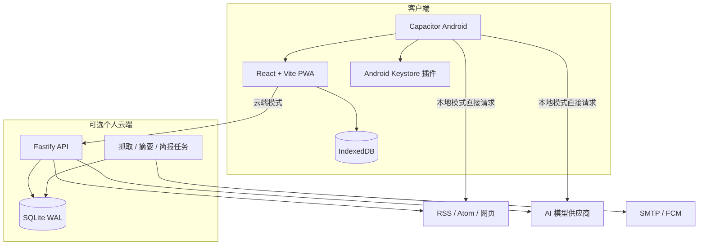

# 架构说明

## 总览

## Android 本地模式

本地模式通过 `local-api.ts` 在客户端实现与云端 API 相近的接口。订阅、文章、监控、模型元数据和偏好保存在 IndexedDB；API Key 由原生插件交给 Android Keystore 派生的不可导出密钥加密后保存。

网络请求使用 Capacitor HTTP 直接访问 HTTPS Feed、网页与模型接口。这样无需自建服务器，但也意味着抓取依赖 App 处于可运行状态，且无法提供稳定的熄屏后台调度。

## 个人云端模式

云端版使用 Fastify 提供认证、订阅、文章、模型、精选、整合、监控和简报接口。SQLite 运行在 WAL 模式，适合单用户个人规模。后台任务负责到期来源刷新、文章两阶段处理和简报生成。

Docker Compose 负责单容器部署；可选 Caddy 终止 TLS。生产环境必须配置独立的 Token Secret 和 Key 加密 Secret。

## 内容处理流水线

1. 验证远程 URL，抓取并限制响应大小、超时与重定向。
2. 解析 RSS/Atom，规范化文章标识、时间、媒体和来源信息。
3. 对新文章进行去重、主题分类、监控匹配和初始重要性评分。
4. 两阶段 AI 处理：先并发生成双语标题，再并发生成短中文摘要。
5. 文章被打开时提取完整网页正文，清洗后按段落分块翻译，并保持原顺序。
6. 精选只使用有限候选；跨来源整合先做相关性筛选，再把带编号的证据交给分析模型。

## 模型路由与故障恢复

模型角色为 `summary`、`translation` 和 `analysis`。每个角色按优先级最多选取 4 个启用模型。请求失败后依次尝试备用模型，并把认证、额度、超时、网络或供应商错误映射为可读状态。

云端并发默认值：摘要 8、普通翻译 8、分析 4、DeepSeek 翻译 64。DeepSeek 翻译并发可通过 `DEEPSEEK_TRANSLATION_CONCURRENCY` 设置为 8–128。提高并发会增加限流、费用、内存和网络压力，不代表供应商一定允许同等并发。

## 信任边界

- Feed、网页、OPML、图片和模型输出均不可信。
- 本地模式只能在 JavaScript 层检查目标地址，仍需正视 DNS 重绑定残余风险。
- 云端对初始地址和重定向做解析检查，但生产环境仍建议用防火墙限制容器访问私网与云元数据。
- AI 不拥有工具、数据库或密钥读取权限；提示词隔离能降低但不能消除间接提示词注入。
- 远程图片使用无 Referrer 策略，但来源服务器仍能看到请求 IP。

更完整的风险与缓解措施见 [SECURITY.md](SECURITY.md) 和 [ADVERSARIAL_REVIEW.md](ADVERSARIAL_REVIEW.md)。
